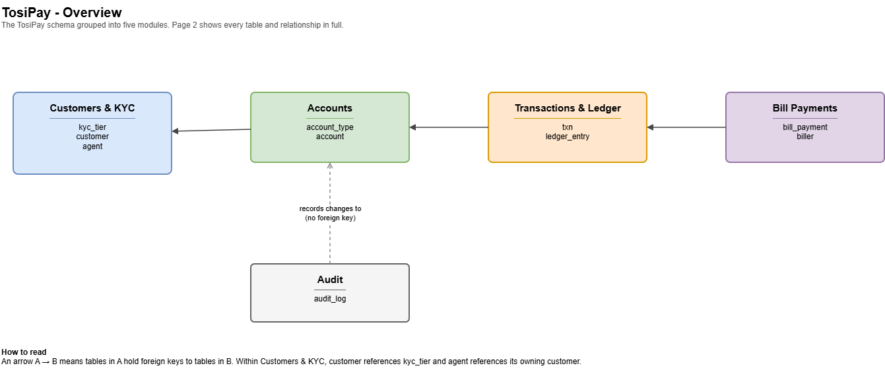
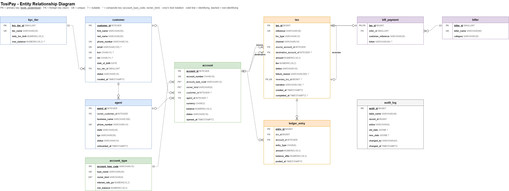

# Portfolio 1: Database Design and Modelling

Relational design for **TosiPay**, a simulated Nigerian mobile wallet and agent
banking platform (see the [main README](../README.md) for the case study
statement). The design is implemented in PostgreSQL and tested with scripts
that try to insert invalid data and check the sample data for consistency.

## Files

| File | Purpose |
|---|---|
| [er-diagram.drawio](er-diagram.drawio) | ER diagram (draw.io). Page 1 is a module overview; page 2 is the full ER diagram with every column, key and relationship. |
| `er-diagram-overview.png`, `er-diagram-full.png` | PNG exports of the two diagram pages. |
| [schema.sql](schema.sql) | Creates the `tosipay` schema: 10 tables, keys, constraints and 2 triggers. Re-runnable. |
| [seed.sql](seed.sql) | Fictional sample data: 6 customers, 2 agents, 11 accounts, 14 transactions and the matching ledger entries. |
| [constraint-tests.sql](constraint-tests.sql) | 22 negative tests (bad data must be rejected) and 4 consistency checks. |
| [evidence/constraint-tests.txt](evidence/constraint-tests.txt) | Output of the latest `constraint-tests.sql` run (22 PASS, all consistency checks clean). |

## How to run

Needs PostgreSQL 16 or later (tested on PostgreSQL 18). Run the scripts in
this order:

```bash
createdb -U postgres tosipay
psql -U postgres -d tosipay -f schema.sql
psql -U postgres -d tosipay -f seed.sql
psql -U postgres -d tosipay -f constraint-tests.sql
```

## ER diagram





### Entities and relationships

| Relationship | Cardinality | How it is implemented |
|---|---|---|
| KYC tier – customer | 1 : N | `customer.kyc_tier_id` → `kyc_tier` |
| Customer – agent (owner) | 1 : N | `agent.owner_customer_id` → `customer` |
| Customer – account | 1 : N (optional) | `account.customer_id` → `customer` |
| Agent – account (float) | 1 : N (optional) | `account.agent_id` → `agent` |
| Account type – account | 1 : N | composite FK `(account_type_code, owner_kind)` → `account_type` |
| Account – transaction | 1 : N, twice | `txn.source_account_id` and `txn.destination_account_id` → `account` |
| Transaction – reversal | 1 : 0..1 (recursive) | `txn.reverses_txn_id` → `txn`, `UNIQUE` |
| Transaction – bill payment | 1 : 0..1 (subtype) | `bill_payment.txn_id` is both PK and FK → `txn` |
| Biller – bill payment | 1 : N | `bill_payment.biller_id` → `biller` |
| Transaction – ledger entry | 1 : N | `ledger_entry.txn_id` → `txn` |
| Account – ledger entry | 1 : N | `ledger_entry.account_id` → `account` |

An account has exactly one owner, which can be a customer, an agent, or
TosiPay itself (the settlement and fee income accounts). This is an
**exclusive arc**: `customer_id` and `agent_id` are both nullable, and a CHECK
constraint makes sure the right one (or neither, for SYSTEM accounts) is filled.

## Design decisions

1. **Transaction header plus double-entry ledger.** `txn` records the
   instruction (who, what, how much, status). `ledger_entry` records the money
   movement as balanced debits and credits. A failed transaction keeps its
   `txn` row for audit but has no ledger entries, so it cannot move money.
   This is how real core banking systems separate intent from effect.
2. **Reversals are new transactions, not updates.** A reversal is its own
   `txn` row that points to the original through `reverses_txn_id`. The
   original is marked `REVERSED` but its ledger entries are never changed or
   deleted, so the history is complete.
3. **Agents are linked to customers.** Every agent business is run by a
   registered customer (`owner_customer_id`), so compliance staff can trace a
   person's personal wallet and their agent float account to one identity.
4. **Bill payments are a subtype table.** Biller, meter number and token only
   apply to `BILL_PAYMENT` transactions. Keeping them in `bill_payment` avoids
   three mostly-NULL columns on every row of `txn`.
5. **Money is `NUMERIC(18,2)`**, never `FLOAT`, so amounts are exact.
6. **Audit log uses JSONB.** A trigger copies the old and new row of every
   account change into `audit_log`. JSONB lets one table hold snapshots of
   any table without a column per field.

## Keys

**Primary keys.** Every main table uses a surrogate key
(`GENERATED BY DEFAULT AS IDENTITY`). Natural identifiers such as phone
numbers and account numbers can change or be reassigned, and a short integer
keeps foreign keys small. Two exceptions:

- `account_type` uses its code (`'WALLET'`, `'SAVINGS'`) as the primary key,
  because the code is short, stable and readable in queries.
- `bill_payment` uses `txn_id` as its primary key, since it is a 1:1 subtype
  of `txn`.

**Candidate (alternate) keys**, enforced with `UNIQUE`:

| Table | Candidate keys besides the PK |
|---|---|
| `kyc_tier` | `tier_name` |
| `customer` | `phone_number`, `email`, `bvn`, `nin` (nullable ones are unique when present) |
| `agent` | `phone_number` |
| `account_type` | `type_name`; `(account_type_code, owner_kind)` exists as a FK target |
| `account` | `account_number` |
| `txn` | `reference` (idempotency key, so a retried request cannot be posted twice); `reverses_txn_id` (a transaction can only be reversed once) |
| `biller` | `biller_name` |

**Foreign keys.** Every relationship in the table above is a declared
`FOREIGN KEY`. No foreign key uses `ON DELETE CASCADE`: in a financial system,
deleting a customer must never silently delete their accounts or transactions.
Records are closed with a `status` column instead of deleted.

## Constraints

| Business rule | Where it is enforced | Test¹ |
|---|---|---|
| Phone numbers are in `+234XXXXXXXXXX` format | CHECK (regex) + UNIQUE on `customer`, `agent` | A1, A2 |
| BVN and NIN are 11 digits and unique | CHECK + UNIQUE | A6 |
| Customers are at least 18 (so no future date of birth) | `chk_customer_adult` | A21, A22 |
| Tier 1 needs a BVN or NIN; Tier 2 and 3 need both | `chk_customer_kyc_ids` | A3–A5 |
| Account owner matches the account type (wallet → customer, float → agent, GL → TosiPay) | composite FK `fk_account_type` + `chk_account_owner` | A9–A12 |
| Customer and agent accounts cannot be overdrawn | `chk_account_non_negative` | A13 |
| Amount is positive, fee is not negative | CHECK on `txn` | A14 |
| Source and destination accounts differ | `chk_txn_distinct_accounts` | A15 |
| A request reference is used only once | UNIQUE `txn.reference` | A16 |
| A reversal must point to the transaction it reverses, and only reversals can | `chk_txn_reversal_link` | A17 |
| A transaction is reversed at most once | UNIQUE `txn.reverses_txn_id` | A18 |
| A failed transaction must say why; other statuses must not | `chk_txn_failure_reason` | A19 |
| Debits equal credits for every transaction | deferred constraint trigger `trg_ledger_balanced` | A20, B2 |
| Every account change is logged | trigger `trg_audit_account` | — |

¹ Test numbers follow the order of the lines printed by Part A of `constraint-tests.sql` (A1 = first line).

Two rules needed more than a simple CHECK:

- **Account ownership.** A CHECK constraint cannot look at another table, so
  it cannot ask `account_type` who may own a wallet. The fix is to copy
  `owner_kind` into `account` and point a composite foreign key at
  `account_type (account_type_code, owner_kind)`. The FK guarantees the copy is
  correct, and the CHECK can then compare `owner_kind` with the owner columns
  on the same row.
- **Balanced ledger.** The rule spans several rows, so it is a constraint
  trigger. It is `DEFERRABLE INITIALLY DEFERRED`, which means it runs at
  `COMMIT`, after the debit and the credit have both been inserted. If it ran
  after each row, the first entry of every transaction would fail.

## Normalisation

### Functional dependencies

The main functional dependencies (FDs) are listed below. Each table's primary
key is on the left of its first FD.

| Table | Functional dependencies |
|---|---|
| `kyc_tier` | `kyc_tier_id → tier_name, daily_txn_limit, max_balance`; `tier_name → kyc_tier_id` |
| `customer` | `customer_id → all columns`; `phone_number → customer_id`; `email → customer_id`; `bvn → customer_id`; `nin → customer_id` |
| `agent` | `agent_id → all columns`; `phone_number → agent_id` |
| `account_type` | `account_type_code → type_name, owner_kind, interest_rate_pa, min_balance`; `type_name → account_type_code` |
| `account` | `account_id → all columns`; `account_number → account_id`; `account_type_code → owner_kind` (see below) |
| `txn` | `txn_id → all columns`; `reference → txn_id` |
| `biller` | `biller_id → biller_name, category`; `biller_name → biller_id` |
| `bill_payment` | `txn_id → biller_id, customer_reference, token` |
| `ledger_entry` | `entry_id → all columns` |
| `audit_log` | `audit_id → all columns` |

### Normal forms

- **1NF.** Every column holds one atomic value and there are no repeating
  groups. A customer with several accounts has several `account` rows, not
  `account1`, `account2` columns. A transaction's postings are separate
  `ledger_entry` rows. (`audit_log.old_data`/`new_data` are JSONB snapshots
  that are stored and read as a whole, never queried field by field for
  business logic, so they are treated as single values.)
- **2NF.** Every table has a single-column primary key, so no attribute can
  depend on only part of a key. Partial dependencies are impossible.
- **3NF.** No non-key attribute depends on another non-key attribute, with
  the one deliberate exception below. Examples of transitive dependencies
  that were removed during design:
  - KYC limits (`daily_txn_limit`, `max_balance`) depend on the tier, not on
    the customer, so they live in `kyc_tier` and `customer` only stores
    `kyc_tier_id`.
  - Interest rate and minimum balance depend on the account type, so they
    live in `account_type`, not on each account.
  - Biller name and category depend on the biller, so `bill_payment` stores
    only `biller_id`.
- **BCNF.** In every table except `account`, every determinant in the FD list
  is a candidate key (for example `phone_number`, `bvn` and `nin` in
  `customer` all determine the whole row), so those tables are in BCNF.

### Note on `agent.state` and `lga`

At first glance `lga → state` looks like a transitive dependency. It is not
a real FD, because Nigerian LGA names are not unique across states (for
example, there is a Surulere LGA in both Lagos and Oyo). Only the pair
`(state, lga)` identifies an LGA. A separate `lga` lookup table would be the
next step if TosiPay needed reporting by region, but it would not fix a
normal form violation.

### Controlled denormalisation

Three columns are redundant on purpose. Each is kept correct by the database
or checked by a test.

| Column | Why it is redundant | Why it is kept | How it stays correct |
|---|---|---|---|
| `account.owner_kind` | Determined by `account_type_code` (breaks 3NF) | Needed so a CHECK can enforce ownership on the same row | Composite FK to `account_type (account_type_code, owner_kind)` makes a wrong value impossible |
| `account.balance` | Equals credits minus debits in `ledger_entry` | Reading a balance must be fast; summing the full ledger on every app screen would not scale | Test B1 compares every stored balance with the ledger. Updating it in the same transaction as the postings is covered in Portfolio 3. |
| `ledger_entry.balance_after` | Running total of the account's entries | Lets a statement be printed without recalculating history | Written at posting time, never updated |

## Testing and evidence

`constraint-tests.sql` has three parts:

- **Part A** runs 22 invalid inserts and updates inside a transaction that is
  rolled back. Each line prints `PASS` with the PostgreSQL error message if the
  database rejected the bad data, or `FAIL` if it accepted it.
- **Part B** runs 4 consistency queries on the sample data. B1–B3 must return
  no rows, and B4 (the total of all account balances) must be `0.00`, because
  TosiPay is a closed double-entry system: the settlement account's negative
  balance equals the money held in all other accounts.
- **Part C** lists every account a person controls, including an agent
  business they own, to show the customer–agent link working.

The output of the latest run is saved in
[evidence/constraint-tests.txt](evidence/constraint-tests.txt). It was produced with:

```bash
psql -U postgres -d tosipay -f constraint-tests.sql > evidence/constraint-tests.txt 2>&1
```

## Limitations and next steps

- Only primary key and unique indexes exist. Indexes on foreign keys such as
  `ledger_entry.account_id` are added and measured in Portfolio 2.
- Daily limits per KYC tier and per-type minimum balances are stored but not
  yet enforced. They need the posting procedure from Portfolio 3.
- The sample data is small (14 transactions). Portfolio 2 generates a larger
  data set for performance testing.
